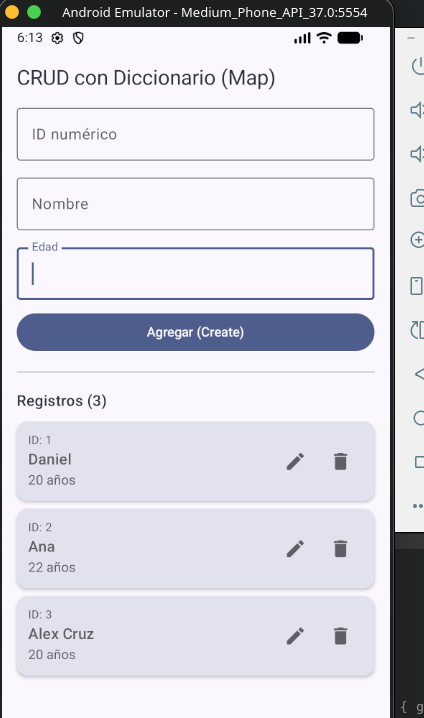

# agenda_jetpack_composer

CRUD de una agenda hecho en Android con Kotlin y Jetpack Compose. Permite agregar, ver, editar y eliminar contactos (ID, nombre y edad), guardados en un diccionario (`Map`) en memoria.

